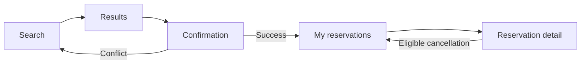
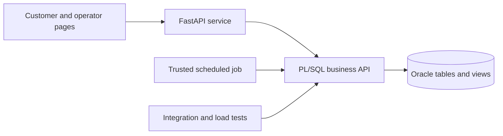
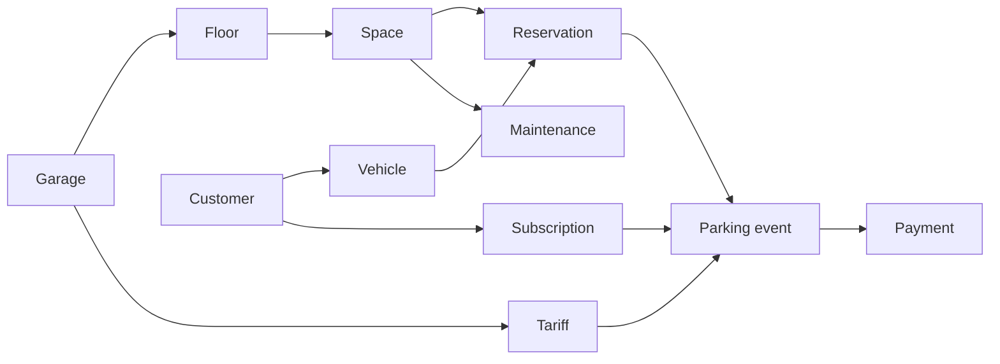

# Smart Parking Garage Management System

Related document: [Project outline](./01-project-outline.md).

This specification defines the proposed semester-1 design. Its policies form one consistent implementation baseline, subject to recorded supervisor feedback. Benchmarks and implementation tests below are planned work, not results already obtained.

## 1. Actors and permissions

| Role | Needs | Responsibility / access |
| --- | --- | --- |
| Customer | Find parking and manage personal activity | Searches availability, registers their vehicles, creates/cancels eligible reservations, and views their own reservations, visits, subscriptions, and recorded payments |
| Operator | Run the garage and handle operational conflicts | Records entry/exit and demonstration payments, schedules maintenance, views occupancy/reports, and cancels a confirmed reservation affected by an operational conflict |
| Administrator | Maintain configuration and accounts | Manages garages, floors, spaces, pricing versions, subscription plans, subscriptions, and staff roles |

Accounts and roles are represented by `user_account`, `app_role`, and `user_account_role`. `customer` links a profile to an account. The service derives actor identity from a verified session rather than accepting a browser-supplied actor ID. PL/SQL checks active account, required role, and record ownership. If database application context is used, it is set through the trusted service boundary and cleared on every pooled-connection checkout/return.

The service database account receives package execution rights and access to approved read interfaces, without general INSERT/UPDATE/DELETE rights on business tables. The schema owner is reserved for installation and controlled administration. Thus public endpoints cannot bypass database procedures. Compromise of the trusted service itself is outside the prototype threat model.

## 2. Use cases / user stories

### 2.1 Search for an available space

- **Actor:** Customer.
- **Precondition:** A garage and future interval are selected; optional filters include floor and space type.
- **Main flow:** The customer submits filters; a database routine validates the interval and returns compatible spaces without blocking reservations, maintenance, disabled state, or known occupation conflicts. The page shows floor/space and indicative pricing.
- **Alternative / error flows:** Invalid or ambiguous local times receive validation feedback. Empty results offer another search. Results are advisory until reservation creation commits.
- **Postcondition:** No reservation or payment is created.

### 2.2 Create a reservation

- **Actor:** Customer.
- **Precondition:** Active account/vehicle, correct ownership, start not in the past, and end later than start.
- **Main flow:**
  1. The customer selects a space/vehicle and confirms with a unique request key.
  2. The service opens a transaction at the chosen isolation level and calls PL/SQL.
  3. The procedure acquires shared resource guards using section 8's protocol.
  4. It rechecks ownership, time, physical restrictions, vehicle/space reservation overlaps, and maintenance.
  5. It inserts one `CONFIRMED` reservation and returns its ID.
  6. The service commits and displays confirmation.
- **Alternative / error flows:** Conflict/validation failure causes rollback. Retrying the same request key with identical owned details returns the existing reservation; changed details are rejected. Bounded contention produces a retryable response. An uncertain commit outcome is reported as unknown and resolved by a fresh request-key lookup, rather than creating another reservation or falsely confirming success.
- **Postcondition:** One reservation commits, or a rejected operation commits no business change.

### 2.3 Cancel a reservation

- **Actor:** Customer; operator for an operational conflict.
- **Precondition:** Status is `CONFIRMED`. Customers cancel only before start. Operators may cancel a still-confirmed reservation after start only to resolve a recorded operational conflict.
- **Main flow:** PL/SQL acquires shared guards, verifies role/ownership/status/time, stores `CANCELLED` with actor/time/reason, and returns for service commit.
- **Alternative / error flows:** Active, completed, no-show, already-cancelled, or non-owned reservations are rejected.
- **Postcondition:** The interval no longer blocks availability. The prototype has no cancellation fee.

### 2.4 Register entry

- **Actor:** Operator.
- **Precondition:** A confirmed reservation exists and database time is within its entry window.
- **Main flow:** PL/SQL acquires the appropriate guards, validates physical availability and entry eligibility, selects the entry-time tariff and eligible subscription, opens one parking event, changes reservation status to `ACTIVE`, and sets physical state to `OCCUPIED` with history. The service commits all changes together.
- **Alternative / error flows:** Early/late entry, duplicate entry, missing tariff, maintenance, or existing occupation causes rollback. Walk-ins are outside the initial scope.
- **Postcondition:** Exactly one open event belongs to the reservation, and the vehicle/space has no other active event.

### 2.5 Register exit and calculate the fee

- **Actor:** Operator.
- **Precondition:** An active reservation has an open parking event.
- **Main flow:** PL/SQL acquires guards, records database exit time, calculates the fee using the immutable entry-time tariff and captured subscription, closes the event, marks the reservation `COMPLETED`, and returns the space to `AVAILABLE` with history. The service commits and displays the amount due.
- **Alternative / error flows:** Duplicate exit or inconsistent open event causes rollback. Overstay charges continue until actual exit; another reservation is never silently cancelled.
- **Postcondition:** The closed visit has an immutable charge. Payment is a separate transaction and is not required to close a prototype visit.

### 2.6 Record a demonstration payment

- **Actor:** Operator.
- **Precondition:** A closed visit or issued subscription has a positive outstanding balance.
- **Main flow:** The operator submits the full amount, a unique reference, and `CASH_DEMO` or `CARD_DEMO`. PL/SQL locks the payable target, checks amount/currency and settlement, and records payment. A subscription payment changes an issued subscription to active.
- **Alternative / error flows:** Wrong target, invalid amount, overpayment, or already-settled balance is rejected. An identical repeat reference returns the original record; different details produce a conflict. Reference checks precede new-balance validation.
- **Postcondition:** The balance is settled once. No money is transferred and no payment-provider call occurs.

### 2.7 Schedule maintenance

- **Actor:** Operator or administrator.
- **Precondition:** Valid interval and existing space.
- **Main flow:** PL/SQL acquires the space guard and inserts the period only after checking blocking reservations, other maintenance, and relevant open events.
- **Alternative / error flows:** A conflict is rejected with a reason. The actor must resolve it before retrying; maintenance does not automatically cancel reservations.
- **Postcondition:** The period is excluded from availability immediately, including when it begins in the future.

### 2.8 View occupancy and reports

- **Actor:** Operator or administrator.
- **Main flow:** Approved views/routines return current physical counts and interval reports, with reservation and overstay information shown separately.
- **Alternative / error flows:** Unauthorized access is denied; an empty period produces an empty-result message.
- **Postcondition:** Operational records are unchanged.

### 2.9 Reconcile time-based statuses

- **Actor:** Trusted scheduled job or authorized operator.
- **Main flow:** Approximately once per minute, a database routine acquires shared guards, marks due confirmed reservations `NO_SHOW`, and records maintenance boundary transitions. Public procedures and effective-state views also check actual timestamps, so a delayed job cannot allow invalid entry/booking.
- **Postcondition:** Stored status and history reflect time-based changes, using ordinary auditable transactions.

## 3. Functional requirements

| ID | Requirement | Acceptance criteria | Priority |
| --- | --- | --- | --- |
| FR-01 | Manage garages, floors, types, and spaces. | Invalid foreign keys and duplicate space numbers within a floor are rejected. | Must |
| FR-02 | Manage accounts, roles, customers, and vehicles. | Customers can use only their vehicles; duplicate country/normalized-plate identities are rejected. | Must |
| FR-03 | Search availability in the database. | Returned spaces meet filters and exclude blocking reservations, maintenance, disabled spaces, and known occupation conflicts. | Must |
| FR-04 | Create reservations through PL/SQL. | A valid uncontended request commits one confirmed reservation; identical request-key replay does not duplicate it. | Must |
| FR-05 | Prevent concurrent conflicting allocations. | Reservation/reservation and reservation/maintenance races produce zero overlapping committed blocking allocations. | Must |
| FR-06 | Cancel eligible reservations. | Customer cancellation before start releases the interval; active and non-owned reservations are rejected. | Must |
| FR-07 | Register entry atomically. | An eligible entry opens one event, marks ACTIVE, and changes physical state to OCCUPIED in one commit. | Must |
| FR-08 | Register exit atomically. | Exit closes the event, stores its charge, marks COMPLETED, and releases occupation in one commit. | Must |
| FR-09 | Calculate fees in the database. | Section 4's examples and boundary tests return their documented amounts. | Must |
| FR-10 | Maintain tariff versions. | Exactly one tariff applies at entry; used pricing fields cannot be modified. | Must |
| FR-11 | Record demonstration payments. | Exactly one payable target is linked and settled once; duplicate-reference behavior follows use case 2.6. | Must |
| FR-12 | Manage plans and subscriptions. | Payment activates an issued subscription; only eligible entry-time subscriptions affect a visit fee. | Must |
| FR-13 | Schedule maintenance safely. | Conflicting reservations, relevant open events, or other maintenance cause rejection without inserted records. | Must |
| FR-14 | Preserve state/audit history. | Changes identify time, actor/source, reason where applicable, and relevant old/new values. | Must |
| FR-15 | Enforce permissions and ownership. | Manipulating browser identifiers cannot expose or modify another customer's records. | Must |
| FR-16 | Display occupancy and statistics. | Mutually exclusive physical counts reconcile with effective database state; reservation counts remain separate. | Must |
| FR-17 | Provide at least ten complex queries. | The portfolio covers intervals, occupancy/utilization, recorded revenue, history, and multi-table aggregation. | Must |
| FR-18 | Generate large data reproducibly. | A fixed seed creates at least 100,000 reservations and at least 100,000 parking-event rows with valid relationships/intervals. | Must |
| FR-19 | Reconcile no-shows and maintenance. | Entry is rejected at the cutoff even while the scheduler is delayed. | Must |
| FR-20 | Expose overstays and blocked arrivals. | An open overdue visit is flagged and a competing physical entry is rejected with operator feedback. | Must |
| FR-21 | Export aggregated reports. | Authorized users can export selected aggregated results. | Should |
| FR-22 | Add a separate maintenance-staff role. | If added, the role cannot access customer financial data. | Could |

Priority: **Must** = required before final thesis completion; **Should** = secondary; **Could** = optional. The first semester-2 MVP is a smaller milestone within this final scope, defined in section 8.

## 4. Business rules and constraints

### 4.1 Integrity and interval rules

| ID | Rule | Database enforcement / rationale |
| --- | --- | --- |
| BR-01 | End must be later than start. New reservations cannot start in the past. | Static checks and authoritative database-time validation. |
| BR-02 | Intervals are half-open: `[start, end)`. | Adjacent allocations may meet at one timestamp. |
| BR-03 | Overlap means `existing.start < requested.end AND existing.end > requested.start`. | Shared predicate for vehicle/space reservations and maintenance. |
| BR-04 | CONFIRMED and ACTIVE reservations block their intervals. | Due no-shows are reconciled or excluded by the authoritative time-aware check. |
| BR-05 | The vehicle must be active and owned by the customer. Ownership is fixed once used in a reservation. | Foreign keys and PL/SQL validation; ownership transfer is outside scope. |
| BR-06 | A vehicle cannot have overlapping blocking reservations in different spaces. | Vehicle guard and overlap check. |
| BR-07 | Floors belong to one garage; spaces belong to one floor. | Non-null FKs and unique space number within floor. |
| BR-08 | Country/normalized plate uniquely identifies a vehicle. | Unique constraint; normalization trims, uppercases, and removes documented separators. |
| BR-09 | One event per reservation, and one ACTIVE reservation per vehicle/space. | Unique event reservation key and conditional unique indexes on ACTIVE reservation identifiers. |
| BR-10 | Disabled spaces and overlapping maintenance are unavailable. | Effective-state views and authoritative procedure checks. |
| BR-11 | Every availability mutation uses shared guards. | Guard, check, mutation, and audit occur in one transaction. |
| BR-12 | Maintenance cannot override blocking reservations or relevant open visits. | Reject conflicts and require prior operator resolution. |
| BR-13 | Customers cancel only confirmed reservations before start. | Role/status/time checks; operator conflict cancellation requires a reason. |
| BR-14 | Entry/exit use database time in normal operation. | Historical fixture loading is a separate privileged tool. |
| BR-15 | Charges are nonnegative decimals in one currency per garage; currency cannot change after pricing/financial use. | NUMBER types, constraints, and fee rules preserve historical monetary meaning. |
| BR-16 | Tariff periods for one garage/type cannot overlap; used pricing/plan versions and captured subscription validity dates are immutable. | Serialized administration and version references; subscription cancellation records a separate status/time. |
| BR-17 | A payment targets exactly one event or subscription. | Exclusive-target check constraint and FKs. |
| BR-18 | Record the full positive outstanding balance once. | Target locking, successful-target uniqueness, and unique reference. |
| BR-19 | Closed events and recorded payments are immutable through normal workflows. | Restricted privileges; no routine physical deletion or refunds. |
| BR-20 | The service supplies trusted identity; PL/SQL checks are authoritative. | Execute-only business access, verified actor propagation, and ownership validation. |

### 4.2 Reservation lifecycle

The initial statuses are `CONFIRMED`, `ACTIVE`, `COMPLETED`, `CANCELLED`, and `NO_SHOW`. Creation confirms directly; no temporary pending hold is used.

| Case / transition | Initial policy |
| --- | --- |
| Creation | Valid request creates CONFIRMED. |
| Entry | CONFIRMED becomes ACTIVE only in `[start, min(start + 15 minutes, end))`; early entry is rejected. |
| Customer cancellation | CONFIRMED becomes CANCELLED before start, with no fee. |
| Operator cancellation | A still-confirmed operational conflict may be cancelled with actor/reason, including after start. |
| No-show | At `min(start + 15 minutes, end)` or later, an unentered confirmed reservation becomes NO_SHOW, with no penalty. |
| Exit | ACTIVE becomes COMPLETED; early exit releases the unused allocated remainder. |
| Overstay | Status remains ACTIVE until actual exit; normal charges continue, and the next vehicle cannot enter an occupied space. |
| Terminal status | COMPLETED, CANCELLED, and NO_SHOW cannot return to blocking status. Rescheduling requires cancellation and a new reservation. |

Before a visit's reserved end, a search for a later interval estimates availability; it cannot guarantee physical departure. An open visit that has passed its reserved end conservatively blocks new reservations for the space until exit. Overstay never automatically cancels or reallocates the next reservation. Operators receive a conflict and can explicitly cancel a still-confirmed affected reservation. Reports distinguish operational from voluntary cancellation.

### 4.3 Physical state and time

Physical states are `AVAILABLE`, `OCCUPIED`, `MAINTENANCE`, and `OUT_OF_SERVICE`. A `RESERVED` label is derived for a requested interval and is not stored as a physical state on an empty space. Operator physical counts are mutually exclusive; reservation counts are separate.

Entry changes AVAILABLE to OCCUPIED and exit changes it back. Nonconflicting maintenance boundaries change AVAILABLE to/from MAINTENANCE. Disable/enable changes AVAILABLE to/from OUT_OF_SERVICE after conflict checks. Disabling an occupied space or one with unresolved future bookings is rejected. Future maintenance immediately affects interval searches but changes physical state only at its boundary.

A minute-based scheduled job records time-driven changes. Effective-state queries and procedures independently evaluate actual timestamps and maintenance periods if the job is delayed. Triggers may record state/audit history transactionally; they do not fire simply because time passes. Audit failure rolls back its business change.

Timestamps are stored timezone-aware in UTC; input/display uses the configured garage time zone. Ambiguous or nonexistent daylight-saving times must be resolved or rejected. Fees use elapsed seconds, not local wall-clock subtraction.

### 4.4 Fee policy and worked examples

The first model uses a rate, grace duration, and cap per successive 24 hours of chargeable duration. The fixture below uses **EUR 2.00/hour**, **10 minutes grace**, and a **EUR 12.00 cap** as proposed test values, not commercial pricing.

1. At actual entry select one applicable immutable tariff version and retain its ID.
2. Compute `D = max(elapsed_seconds - grace_seconds, 0)`.
3. Partition D into full 24-hour blocks and a remainder. Each full block costs `min(24 * rate, cap)`. A positive remainder costs `min(ceil(remainder / 3600) * rate, cap)`; a zero remainder costs zero.
4. Apply a subscription percentage only if the paid subscription captured at entry covers the entire actual stay. Expiry during a stay gives no discount. Later cancellation stops new eligible visits but does not retroactively change an already captured benefit.
5. Round the final decimal amount to two places using Oracle ROUND, and store the immutable billed charge. A zero-charge visit needs no payment.

Caps apply to chargeable-duration blocks after grace, not calendar days. A tariff change during a visit does not split its charge. At most one applicable subscription can cover a customer/garage period; discounts do not stack.

| Actual stay | Chargeable duration | Expected fee |
| --- | --- | ---: |
| 10 minutes | 0 | EUR 0.00 |
| 11 minutes | 1 minute | EUR 2.00 |
| 70 minutes | 60 minutes | EUR 2.00 |
| 71 minutes | 61 minutes | EUR 4.00 |
| 6 hours 10 minutes | 6 hours | EUR 12.00 |
| 7 hours 10 minutes | 7 hours, capped | EUR 12.00 |
| 24 hours 10 minutes | One full block | EUR 12.00 |
| 24 hours 11 minutes | One block plus 1 minute | EUR 14.00 |

An eligible 20% subscription makes the last example EUR 11.20. If it expires before exit, the amount remains EUR 14.00. Tests also cover zero/negative duration, exact boundaries, multi-day stays, tariff validity, and daylight-saving changes.

## 5. User interface and workflow

Customer navigation contains **Search**, **My reservations**, **My vehicles**, and **My history**. Staff access **Occupancy**, **Entry/exit**, **Maintenance**, and **Reports**. These low-fidelity wireframes specify essential controls and feedback; example labels/amounts are illustrative.

### 5.1 Search and results

```text
SMART PARKING                         Search | My reservations | Sign out
Garage [ Central v ]  Floor [ Any v ]  Type [ Standard v ]
Start [ date / time ]                 End [ date / time ]
[ Search available spaces ]

Space     Floor    Type       Indicative rate         Action
A-012     1        Standard   EUR 2.00 / hour          [ Select ]
A-018     1        Standard   EUR 2.00 / hour          [ Select ]

Empty result: No matching space. Change the interval or filters.
Validation: End must be after start; resolve ambiguous local time.
```

### 5.2 Confirmation

```text
CONFIRM RESERVATION
Garage / floor / space: Central / 1 / A-012
Interval: [ selected start ] to [ selected end ]
Vehicle: [ My registered vehicle v ]
Pricing: Actual duration is billed under the entry-time tariff.
[ Confirm reservation ]                          [ Back to results ]

Success: Reservation R-1042 confirmed. [ My reservations ]
Conflict: Space is no longer available. [ Search again ]
Busy: Request could not complete. [ Retry ]
Unknown response: Check the existing request before submitting again.
```

### 5.3 Personal reservations and cancellation

```text
MY RESERVATIONS                        Status [ All v ] Period [ ... ]
ID       Space     Vehicle     Interval          Status       Action
R-1042   A-012     My vehicle  [ start / end ]   CONFIRMED    [ View ]

Detail: ID, garage, space, vehicle, interval, status, cancellation policy
[ Cancel reservation ] (only when customer cancellation is eligible)
Confirm? [ Yes, cancel ] [ Keep reservation ]

Success: Cancelled; the interval has been released.
Failure: Status or time changed. [ Refresh ]
```

### 5.4 Operator occupancy, entry, and exit

```text
OPERATOR                            Occupancy | Entry/exit | Maintenance
Garage [ Central v ] Floor [ All v ] As of [ database timestamp ]
Available: 42   Occupied: 18   Maintenance: 3   Out of service: 1
Reservations active now: 20              Open overstays: 1

Spaces: [ space ] [ physical state ] [ current visit / conflict ]
Reservation lookup [ ID or plate ]                           [ Find ]
[ Register entry ]        Open visit [ ... ]        [ Register exit ]

Exit result: Closed visit, billed amount, outstanding balance.
[ Record demonstration payment ]
Conflict: Previous vehicle remains in the space. Operator action needed.
```

Maintenance uses a space selector, interval, reason, and Schedule button. Rejection identifies the conflicting booking/visit without exposing private details to customers. Reports use garage/date filters and tabular results. Authentication uses a minimal sign-in form; an external identity provider is not required.

### 5.5 Navigation and errors



The transaction always rechecks availability. User feedback separates invalid input, unavailable space, temporary busy operations, and unknown request outcomes without leaking another customer's details.

## 6. Non-functional requirements

| ID | Requirement | Verification |
| --- | --- | --- |
| NFR-01 | Zero conflicting committed allocations under parallel access. | Reservation/reservation, reservation/maintenance, cancel/create, entry/entry, and exit/entry race tests, followed by an independent integrity scan. |
| NFR-02 | Atomic business and audit changes. | Inject failures between steps and verify full rollback of all affected records. |
| NFR-03 | Proposed availability target: warm-run p95 under 2 seconds for representative single-client searches. | Use at least 100,000 reservations and 100,000 events, five warm-ups and 30 measurements per parameter set; record hardware/versions. This is a target, not a result. |
| NFR-04 | Measure at least five optimizations quantitatively. | Before/after elapsed time, logical reads/buffer gets, rows, and plans on identical seeded data. |
| NFR-05 | Reproducible setup and generation. | Clean-schema rebuild using versioned scripts, fixed seed, exact dependencies, and documented execution order. |
| NFR-06 | Safe authentication and secrets. | Role/ownership tests, parameterized calls, hashed passwords, environment configuration, and repository inspection. |
| NFR-07 | Deterministic fees and historical charges. | Check worked boundaries and that new pricing versions do not alter closed charges. |
| NFR-08 | Bounded contention handling. | Candidate A uses five-second guard waits; tests check rollback, retryable errors, and lock release. Candidate B uses a verified bounded call deadline. |
| NFR-09 | Understandable main workflow. | A representative tester completes search–reserve–view–cancel without developer assistance. |
| NFR-10 | Correct time-based eligibility despite delayed reconciliation. | Delay the scheduler and verify timestamp-based checks and eventual audit history. |

## 7. Open questions and risks

### Initial decisions

| Decision | Baseline | Status |
| --- | --- | --- |
| Data volume | At least 100,000 reservations and 100,000 parking events, counted separately | Adopted proposal removing count ambiguity |
| Entry | Reservation required; no early entry; cutoff after 15 minutes or at end, whichever is earlier | Proposed policy for supervisor review |
| Cancellation/no-show | Before-start customer cancellation; no penalties; operator conflict cancellation recorded separately | Proposed policy |
| Maintenance | Reject conflicting periods; no automatic cancellation | Proposed policy |
| Pricing | Entry-time tariff, chargeable-duration cap, full-stay subscription eligibility | Proposed policy with worked examples |
| Transaction owner | Service commits/rolls back; PL/SQL validates and mutates | Initial architecture decision |
| Stack | Oracle SQL/PLSQL, FastAPI, small server-rendered pages | Technical proposal, not a completed installation |

| Risk / question | Impact | Owner | Resolution / fallback |
| --- | --- | --- | --- |
| Oracle version and environment availability | Installation and driver compatibility | Student / supervisor | Validate an accessible modern Oracle environment; record versions. If 11g is required, verify a compatible Thick-mode client stack. |
| Supervisor prefers different arrival or pricing rules | Behavior and tests | Student / supervisor | Review the explicit baseline and record changes consistently across documents. |
| Per-resource contention reduces throughput | Parallel performance | Student | Benchmark hot-space and dispersed-space workloads for both safe candidates. |
| Generated histories fail to represent realistic distributions | Evaluation validity | Student | Define seeded skew/status/time distributions and validate integrity before timing. |
| Environment restricts scheduled jobs | Stored status timeliness | Student | Prefer DBMS_SCHEDULER; otherwise a trusted scheduled service calls the same PL/SQL API. |
| Additional evaluation rules or presentation timing | Formal/oral assessment | Student / course staff | Check the announced time limit and complete evaluation document; neither was supplied with the samples. |

Supervisor and presentation feedback will be recorded as dated decisions or open items. No baseline choice is described as already approved by the supervisor.

## 8. Initial technical specification proposal

### 8.1 Proposed solution and technology direction

The Oracle database contains normalized entities, constraints, indexes, views, PL/SQL packages, and selected transactional logging triggers. FastAPI verifies identity and calls this API. Server-rendered HTML with minimal JavaScript demonstrates the workflows. The database remains authoritative for business validation.

| Area | Proposal | Reason / early validation |
| --- | --- | --- |
| Database | Accessible modern Oracle Database environment | Native PL/SQL, isolation, locking, and plan analysis; verify access first. |
| Database logic | SQL, PL/SQL packages/functions, constraints, limited audit triggers | Keep rules enforceable and testable at the database boundary. |
| Service | FastAPI with python-oracledb | Small API and convenient integration/concurrency tooling; prototype one procedure call. |
| Driver mode | Thin for compatible modern DB; verified Thick stack if 11g is required | Record driver/client/server versions and process architecture; do not assume default Thin mode supports legacy DB. |
| Interface | Server-rendered HTML, simple CSS, minimal JavaScript | Keep focus on database work. |
| Testing | SQL/PLSQL assertions and Python integration/load scripts | Test boundaries, rollback, ownership, and concurrent modifications. |
| Delivery | GitHub, Trello, reproducible scripts | Canonical planning documents live in `00-project/`; enter real links in the outline. |

Technical references: [Oracle concurrency/isolation](https://docs.oracle.com/en/database/oracle/oracle-database/19/cncpt/data-concurrency-and-consistency.html) and [python-oracledb compatibility](https://python-oracledb.readthedocs.io/en/latest/user_guide/installation.html).

### 8.2 Architecture and responsibilities



The browser handles input/feedback. The service authenticates, binds parameters, owns transactions, and maps errors. PL/SQL checks permissions, intervals, fees, transitions, and concurrency guards. Constraints protect static/unique invariants. State/audit changes participate in the same transaction. Reports access approved interfaces. Bulk fixture loading uses a separate privileged test account.

The initial package API will expose the following responsibilities; precise parameter types and error codes are finalized with the logical schema. Actor identity comes from the trusted service boundary described in section 1, never from a customer's arbitrary identifier field.

| Proposed routine | Inputs / result |
| --- | --- |
| `search_available_spaces` | Garage, interval, optional floor/type; returns a result cursor without mutation |
| `create_reservation` | Vehicle, space, interval, request key; returns the reservation identifier |
| `cancel_reservation` | Reservation and permitted reason; validates eligibility and records cancellation |
| `register_entry` | Reservation; uses database time and returns the open event identifier |
| `register_exit` | Open event; uses database time and returns the finalized charge |
| `calculate_parking_fee` | Event and validated exit timestamp; deterministic NUMBER result without internal commit |
| `record_payment` | Event or subscription target, amount, method, reference; returns recorded payment identifier |
| `schedule_maintenance` | Space, interval, reason; returns maintenance identifier or conflict |
| `reconcile_due_states` | Controlled processing boundary/batch; applies auditable time-based changes |

### 8.3 Data model proposal and normalization

| Table | Purpose / important relationship |
| --- | --- |
| `user_account` | Authenticated identity, password hash, active flag |
| `app_role` | Customer/operator/administrator roles |
| `user_account_role` | Account–role link with unique account/role pair |
| `customer` | Profile and unique account FK; entitlement guard/version |
| `vehicle` | Customer FK, country/normalized plate, vehicle guard/version |
| `parking_garage` | Identity, address, time zone, currency, pricing guard/version |
| `garage_floor` | Garage FK and unique floor code per garage |
| `parking_space_type` | Controlled categories |
| `parking_space_state` | Controlled physical states |
| `parking_space` | Floor/type/state FKs, number, space guard/version |
| `parking_space_state_history` | Space, old/new state, actor/source, timestamp |
| `reservation` | Vehicle/space FKs, interval/status, unique request key, cancellation/no-show metadata |
| `parking_event` | Unique reservation FK, entry/exit, tariff/subscription references, billed amount |
| `tariff` | Garage/type FKs, validity interval, rate/grace/cap, immutable pricing version |
| `subscription_plan` | Garage FK, price/percentage, immutable plan version |
| `subscription` | Customer/plan FKs, validity interval, issued/active/cancelled status |
| `payment` | One event/subscription target, amount/currency/method, unique reference |
| `maintenance_period` | Space FK, interval/reason, actor |
| `audit_log` | Actor/source, operation/record, time/reason, relevant changes |

The **19 related tables** exceed the twelve-table minimum. Primary keys, foreign keys, checks, uniqueness, and conditional indexes will be specified in the logical model and DDL.



This sketch shows major dependencies, not a cardinality-complete ERD. The logical-design milestone will define attributes, cardinalities, keys, and functional dependencies and demonstrate at least 3NF. Ownership is stored on the vehicle, not duplicated on every reservation. Garage details follow floor/space FKs. An event derives vehicle and space through its reservation. Duration and report aggregates are calculated; the finalized billed charge is an immutable financial fact. Any additional stored derived field requires an explicit design justification.

### 8.4 Transaction and concurrency contract

The service owns one transaction per operation with autocommit disabled. Candidate A uses READ COMMITTED; candidate B sets SERIALIZABLE before the first SQL statement of every attempt. Packages contain no internal COMMIT and no autonomous business/audit transactions. The caller commits success or rolls back the whole failed operation. Scheduled and test clients obey the same contract.

Lock/guard order is deterministic: customer entitlement rows when needed, vehicle rows, garage pricing rows when needed, space rows, then reservation/event/payable rows. Within a class, IDs are ascending. An operation needing only a space, such as maintenance, never subsequently acquires an earlier resource class. Entry uses entitlement/pricing guards to choose versions consistently; pricing and subscription administration use the corresponding shared guards. Reservation creation normally needs only its vehicle and space. Resource identifiers derived before acquisition are revalidated after acquisition.

Creation/cancellation, entry/exit, no-show reconciliation, maintenance creation/removal, and space disable/enable all share the per-space protocol. Vehicle eligibility changes use the vehicle guard. Both candidates perform real version-advancing updates to affected guards, so a SERIALIZABLE participant can detect a relevant change committed by either candidate. Guards remain held until caller commit/rollback. Used topology and vehicle ownership are not edited beneath reservations.

| Candidate | Safe algorithm | Measurement focus |
| --- | --- | --- |
| A: Explicit row locking | READ COMMITTED; acquire relevant guards using `SELECT ... FOR UPDATE WAIT 5`, advance versions, run a separate fresh overlap/state query after acquisition, perform writes, and commit through caller. | Waits, hot-space latency, throughput, timeouts. |
| B: Guarded SERIALIZABLE | Begin a fresh SERIALIZABLE transaction, actually update the same guards before authoritative checks, then write. ORA-08177 causes full rollback and a fresh transaction/snapshot, with at most three attempts. | Serialization failures, retries, time, parallel consistency. |

Updating a common guard creates the necessary shared write conflict for candidate B. Merely checking overlaps and inserting different reservation rows under SERIALIZABLE would not provide that guard. Such an unguarded version may be tested only as an unsafe negative control. Candidate safety will be verified through independent race tests and integrity scans; no benchmark result is claimed yet.

Candidate A is provisionally preferred because a per-space serialization point plus a fresh check is straightforward. Candidate B uses a bounded database-call deadline verified during the environment prototype, with full rollback on timeout/deadlock. Retries redo all checks in a new transaction. An uncertain commit is reconciled through the unique reservation request key before reporting or replaying the operation.

Compare 1, 2, 4, 8, and 16 parallel clients, hot-space versus dispersed-space workloads, and five runs per configuration with identical seeds/request sets. Record committed/rejected requests, independent integrity violations, median/p95 latency, throughput, waits/timeouts, serialization failures, and retries. Include interval-boundary and reservation-versus-maintenance/cancellation/entry/exit races. Zero conflicting committed allocations is mandatory.

### 8.5 Query portfolio and optimization plan

| Query | Planned analysis |
| --- | --- |
| Q01 | Interval availability by garage/floor/type |
| Q02 | Effective physical occupancy by garage/floor |
| Q03 | Hourly/daily occupancy trend from actual visits |
| Q04 | Space utilization over a selected interval |
| Q05 | Recorded parking revenue by garage/month |
| Q06 | Revenue by tariff and demonstration payment method |
| Q07 | Customer reservation/visit/payment history |
| Q08 | Vehicle history and total elapsed duration |
| Q09 | Voluntary cancellation, operational cancellation, and no-show rates |
| Q10 | Subscription use and granted discount totals |
| Q11 | Peak entry/exit periods |
| Q12 | Maintenance downtime and capacity impact |

The first five optimization targets are **Q01, Q03, Q04, Q05, and Q07**. Capture baselines, apply justified indexes/rewrites, and repeat against identical data. Use EXPLAIN PLAN for estimated plans and DBMS_XPLAN.DISPLAY_CURSOR with collected execution statistics where permitted for actual behavior. Compare elapsed time, logical reads/buffer gets, row counts, and access/join paths. Candidate indexes include reservation space/status/time, maintenance space/time, event timestamps, payment target/date, and vehicle ownership; final order depends on measured selectivity.

Record generator revision/seed, DB/client versions, optimizer/statistics settings, hardware, query text/binds, five warm-ups, and 30 measured executions per parameter set. Include selective/broad and empty/nonempty results. Do not flush shared production caches. Any separate cold-run experiment is identified explicitly. Document regressions as well as improvements.

Occupancy uses actual visit intervals clipped to the report window. Utilization defines its denominator as operational space-hours excluding maintenance/out-of-service time. Revenue uses recorded payments by payment time, separately from billed/unpaid charges. Joins must not multiply one payment into several rows. The generator includes valid unpaid visits, additional cancelled/no-show reservations, subscriptions, maintenance, and skewed demand; at least 100,000 visits reference eligible reservations, so the total reservation count may exceed 100,000.

### 8.6 Feasibility milestones and semester-2 MVP

| Milestone | Deliverable / acceptance |
| --- | --- |
| Environment prototype | Verified Oracle/driver combination, one parameterized read and one PL/SQL call. |
| Logical design | Attribute-level ERD, at least 3NF justification, constraints, and reproducible schema scripts. |
| First working MVP | Account/vehicle fixtures, search, safe create/cancel, personal-reservation page, and a two-session race test. Search–reserve–view–cancel succeeds; a competing overlap is rejected. |
| Operational functions | Entry/exit, fees, subscriptions/payments, maintenance, reconciliation, history/audit, and rollback tests. |
| Operator interface | Occupancy, entry/exit, maintenance, and basic reports using database routines. |
| Evaluation | Required seeded volume/integrity checks, twelve query examples, five optimization studies, and both concurrency benchmarks. |
| Packaging | Clean installation, setup/test instructions, version control, limitations, and thesis results. |

The first MVP determines sequencing, not a reduction of final requirements. Complex visual features remain secondary until database correctness and reproducible evaluation are complete.
